# Sobre o Projeto

A **Wade Brasil** nasceu para unir tecnologia, sustentabilidade e desenvolvimento humano em um modelo de negócios preparado para o futuro. O grupo é composto por **três verticais distintas** que compartilham o mesmo DNA sustentável:

| Marca | Segmento |
|-------|----------|
| **Wade** | Biocosméticos |
| **BlueSafe** | Produtos de limpeza |
| **BeFarm** | Setor alimentício |

# Objetivo

Desenvolver uma landing page estratégica para:

- ✅ Centralizar informações das marcas e produtos;
- ✅ Fortalecer a presença digital da Wade;
- ✅ Facilitar o acesso ao ecossistema da empresa de forma simples e organizada;
- ✅ Apresentar a linha do tempo, produtos, oportunidades e canais de contato.

# Funcionalidades

- **Apresentação institucional** com identidade visual unificada do grupo Wade;
- **Linha do tempo interativa** com os principais marcos da empresa (2018–2026);
- **Vitrine de marcas** (Wade, BlueSafe, BeFarm) com destaque para produtos e propostas;
- **Seção de produtos** com descrições detalhadas (ex.: Lava Roupas Enzimático BlueSafe);
- **FAQ (Perguntas Frequentes)** com respostas expansíveis;
- **Área de contato** e footer com links úteis;
- **Design responsivo** para desktop, tablet e mobile.
